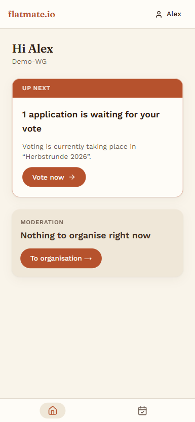
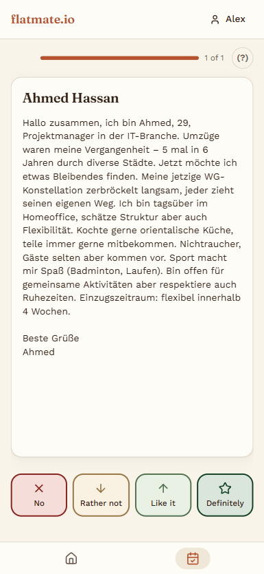
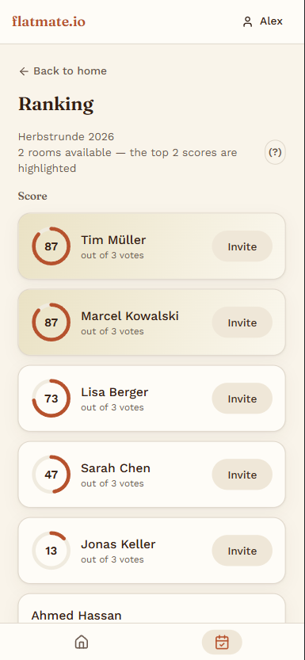
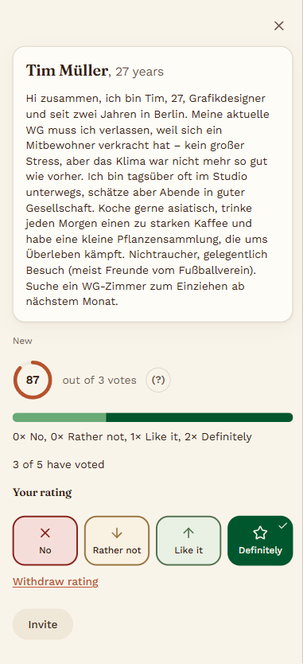

# Flatmate.io

**Choosing a new flatmate together, without the WhatsApp chaos.**

Flatmate.io is a web app for German flat-shares (WGs) and housing projects that need to pick a
new resident. In a large WG this usually takes about 13 steps across four tools, mostly group
chats. One person ends up organising everything, and two or three people end up deciding for
seven. Flatmate.io gives the whole household one shared process: collect applications, rate
them, vote, and see a ranking that everyone can trace.

The product goal: at least 80% of eligible residents cast a vote in each round.

| Dashboard | Voting card | Ranking | Candidate detail |
|---|---|---|---|
|  |  |  |  |

## What it does (v0.1)

- **Open a casting round.** Set up the rooms and rounds for the household.
- **Join in two fields.** Residents join with a household code or an invite link. Applicants
  never need an account.
- **Capture applications.** Enter them by hand, edit them, or delete them.
- **Screen card by card.** Every resident rates each applicant on four criteria.
- **Hidden ranking.** You only see the ranking after you have voted, which stops anchoring and
  bandwagon effects.
- **Privacy built in.** A new resident never sees the votes cast about them. People who move out
  lose access. Every step is recorded in an append-only audit log.
- **German and English UI**, chosen per account.

Planned next: interview scheduling, offers and move-in, notifications, and a PWA.

## Design principles

1. **Channel neutrality.** Anything that can arrive by link can also be typed in by hand.
2. **Device neutrality.** No resident is left out because of the device they have.
3. **Legitimacy over optimality.** Rankings are deterministic and explainable. There are no
   hidden formulas.
4. **Reversibility.** Every step in the pipeline can be undone, and every undo is audited.
5. **No AI in housing decisions.** AI may help structure text. It never ranks, summarises or
   pre-selects people.

## Tech stack

- **Next.js 16** (App Router, Server Actions), **React 19**, **TypeScript** (strict)
- **PostgreSQL on Supabase** (EU) with **Supabase Auth**, accessed through **Drizzle ORM**
- **Tailwind CSS 4**, with hand-built UI components that follow the project's own design system
- **Vitest**, **ESLint**, **dependency-cruiser**, **gitleaks**, **GitHub Actions**

## Engineering highlights

- **Modular monolith.** The code is split into bounded contexts under `src/modules/`: `identity`,
  `casting`, `deliberation` and `audit`. Each context owns its schema and repository, and
  `dependency-cruiser` blocks imports that cross those boundaries.
- **Authorization enforced twice.** Permissions are checked in application code and again by
  Postgres row-level security (RLS), scoped per household. The session context is set in exactly
  one place, with transaction-local settings.
- **Explicit state machines.** An application moves through 11 states. The legal transitions are
  declared in code, and the database itself backs the transitions that have to hold.
- **Privacy as a build gate.** Every database column is listed in `data-inventory.yml` with its
  data category, purpose, legal basis and retention period. CI fails if the schema and the
  inventory disagree.
- **Nine custom lint scripts** (`scripts/lint/`). They enforce rules that general-purpose tools
  can't check: RLS coverage on every table, no role-based shortcuts in authorization checks,
  re-runnable migrations, and a pending state on every form.
- **About 250 test files.** Most are integration tests that run against a real Postgres and
  Supabase Auth, not mocks. Each RLS policy is tested from both sides: what it must allow and
  what it must refuse.
- **CI.** Every pull request starts a disposable Supabase stack inside the runner, builds the
  database from the migrations alone and runs the full `npm run verify` gate. Secret scanning
  runs on every commit, and a license allowlist covers production dependencies.

## How it was built

The project started as a specification. In `docs/` you'll find the problem framing,
requirements, PRD, domain model, 15 Architecture Decision Records, a GDPR compliance appendix,
the screen inventory and the design system. It was then implemented slice by slice with
[OpenSpec](https://github.com/Fission-AI/OpenSpec): every change goes through proposal → design
→ tasks → code → archive (`openspec/`). That added up to more than 30 archived changes and about
90 merged pull requests.

AI coding assistants (Claude Code) were part of the workflow. `CLAUDE.md` and `.claude/rules/`
are their working instructions. The specification, the guardrails and the review loop set what
they were allowed to change.

The project began as the capstone of a DigitaleLeute School bootcamp. The course work is in
`coursework/`.

> **Status:** v0.1, running on synthetic data only. Before real applicants can use it, it still
> needs a data processing agreement, a privacy notice per household and automatic retention.

## Running it locally

Prerequisites: Node 24, a Supabase project (or the Supabase CLI for a local stack) and
[gitleaks](https://github.com/gitleaks/gitleaks), which the pre-commit hook needs.

```bash
npm install
cp .env.example .env.local   # fill in the Supabase URL/keys and DATABASE_URL
npm run dev
npm run seed:demo            # optional: a demo household
npm run verify               # lint, type-check, custom lints, tests
```

## Author

Samuel Zink ([@SmokeyRGB](https://github.com/SmokeyRGB))
